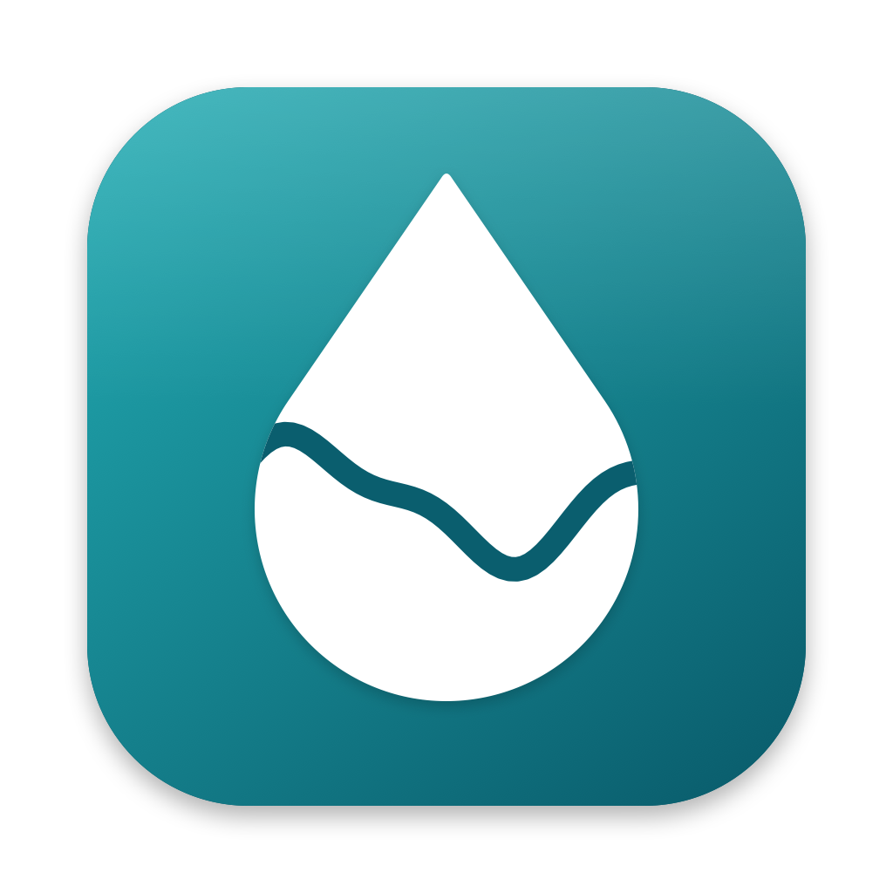
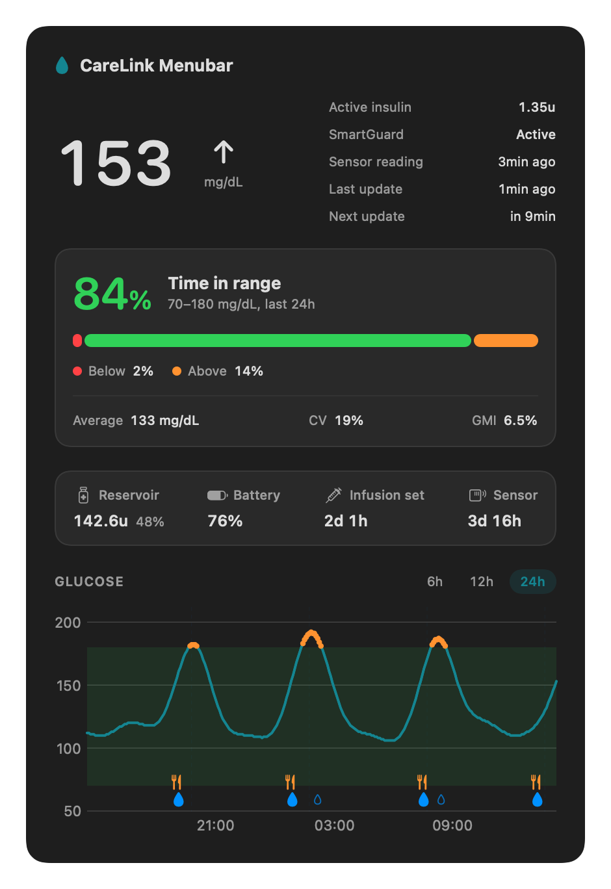
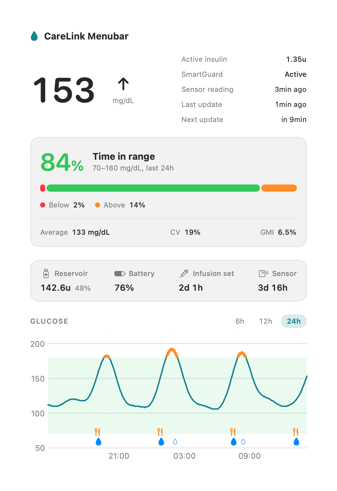
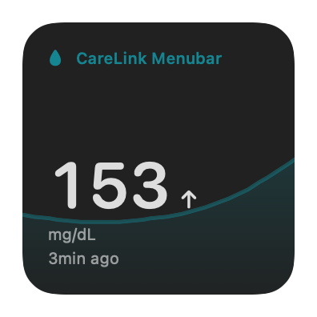
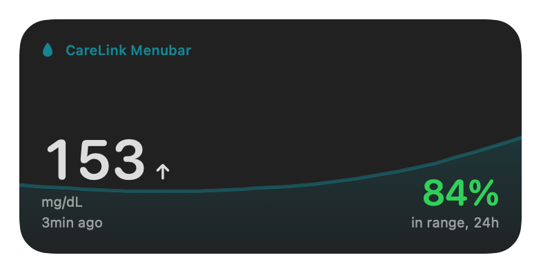
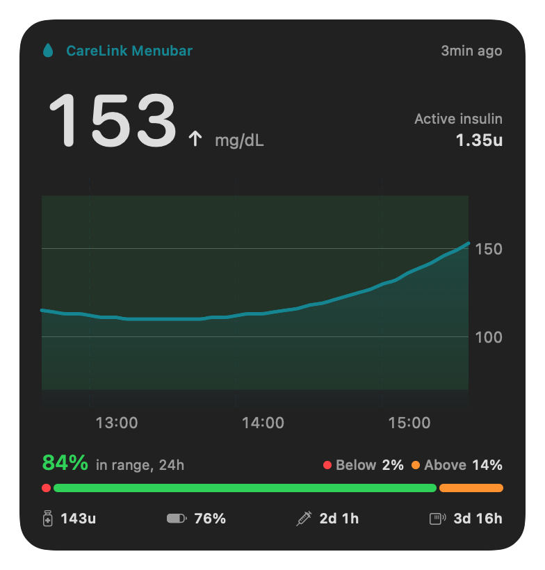

<p align="center">
  
</p>

<h1 align="center">CareLink Menubar</h1>

<p align="center">
  Your glucose from MiniMed CareLink, always one glance away in the macOS menu bar.
</p>

<p align="center">
  
  
  
  
</p>

<p align="center">
  <a href="https://github.com/tixastronauta/carelink-menubar/releases/latest/download/CareLink-Menubar.dmg"><b>⬇ Download for Mac</b></a>
  &nbsp;·&nbsp;
  <a href="https://tixastronauta.github.io/carelink-menubar/">Website</a>
  &nbsp;·&nbsp;
  <a href="#install">How to install</a>
  &nbsp;·&nbsp;
  <a href="https://github.com/tixastronauta/carelink-menubar/releases">All releases</a>
</p>

> [!IMPORTANT]
> **Unofficial and read-only.** CareLink Menubar is not affiliated with, endorsed by or supported
> by MiniMed (formerly Medtronic Diabetes). It only reads data that CareLink already shows you; it never sends commands to a
> pump or changes therapy. It is not a medical device and does not replace your pump, sensor,
> the MiniMed app or their alarms. Always confirm values in the official app.

## Screenshots

<p align="center">
  
  
</p>

<p align="center">
  
  
  
</p>

<sub>Screenshots use synthetic example data generated by <code>tools/make-screenshots.sh</code>.</sub>

## Features

- **Menu bar at a glance:** current glucose, trend arrow and an optional 3-hour sparkline,
  coloured when outside your target range.
- **Detail panel:** active insulin, SmartGuard state, reading and refresh ages, and a 6/12/24-hour
  chart with target band, out-of-range dots, boluses, meals and SmartGuard auto corrections.
- **Time in range card:** CareLink's 24-hour time in range with below/above split, plus average,
  coefficient of variation and GMI.
- **Consumables:** reservoir (units and %), pump battery, infusion set and sensor time left, turning
  orange and red as they near their end.
- **Desktop widgets:** small, medium and large WidgetKit widgets with the real 3-hour trace.
- **Technical notifications:** expired session, no new readings, sensor or infusion set ending.
- **Copy as image:** one click puts a picture of the panel on the clipboard, ready to share.
- **Settings:** launch at login, refresh interval, what to show, target range, account, and
  diagnostics. Portuguese and English, switchable at runtime.

## Requirements

- macOS 14 Sonoma or later (universal binary: Apple Silicon and Intel).
- A European CareLink account (patient, or care partner with exactly one linked patient).
- Developed and validated with a MiniMed Flex on a European account. Other pumps, regions,
  mmol/L accounts and MFA have not been verified.

## Install

1. Download **[CareLink-Menubar.dmg](https://github.com/tixastronauta/carelink-menubar/releases/latest/download/CareLink-Menubar.dmg)** (macOS 14 or later, Apple Silicon and Intel).
2. Open it and drag **CareLink Menubar** onto **Applications**.
3. Open the app from Applications. macOS says it cannot verify the app, because this free build is
   not notarized by Apple. Click **Done**.
4. Open **System Settings → Privacy & Security**, scroll down and click **Open Anyway** next to
   CareLink Menubar. You only do this once per version.

The app appears in the menu bar. Accept the consent screen and sign in on the official CareLink
page; the app never sees or stores your password. To add the desktop widget, right-click the
desktop → **Edit Widgets…** and search for "CareLink".

> [!NOTE]
> Release builds made by GitHub Actions without a signing certificate are ad-hoc signed and do not
> include the desktop widget. Build from source with an Apple Development identity to get it.

## Build from source

Build with the Xcode command line tools:

```sh
git clone https://github.com/tixastronauta/carelink-menubar.git
cd carelink-menubar
python3 tools/build-menubar.py
open "build/CareLink Menubar.app"
```

Python is only used by the build script; the app itself has no runtime dependencies.

- Signing uses a valid **Apple Development** identity when one exists (free with an Apple ID in
  Xcode), otherwise ad-hoc. The desktop widget needs a Team ID, so ad-hoc builds skip it.
- Set `CARELINK_SIGN_IDENTITY` to choose another identity (for example a Developer ID).

`tools/make-dmg.sh` packages the built app into `build/CareLink-Menubar.dmg`.

## Privacy and security

- **Read-only by design:** every request goes through an allowlist of GET endpoints plus the only two
  permitted POST bodies (reading the display data and OAuth sign-in/refresh).
- **Tokens:** stored only in your login Keychain, never in files or logs.
- **Health data on disk:** only after you consent, and only on your Mac:
  - the widget summary, in an App Group shared with the widget;
  - diagnostic logs, when you turn diagnostics on.

  Withdrawing consent deletes these files, signs out and quits.
- **No telemetry:** no analytics and no third-party servers. The app talks only to MiniMed's
  European CareLink endpoints.

See [docs/GUIDE.md](docs/GUIDE.md) for the full user and developer guide, including which
CareLink fields are used and how each was validated.

## Project layout

| Path | Contents |
| ---- | -------- |
| `macos/` | The app, widget extension and synthetic check programs (Swift/SwiftUI, no Xcode project) |
| `tools/` | Build and DMG scripts, icon and screenshot generators, translation check |
| `site/` | The public website, published to GitHub Pages by `.github/workflows/pages.yml` |
| `.github/` | Release and website workflows, release notes template |
| `assets/` | App icon and README screenshots |
| `docs/` | [User and developer guide](docs/GUIDE.md) and [project history](docs/HISTORY.md) |
| `carelink_proto/`, `tests/` | The earlier Python prototype and its tests, kept for reference (needs the upstream client checked out in `vendor/`, not included) |

## Credits and license

Protocol compatibility is derived from
[ondrej1024/carelink-python-client](https://github.com/ondrej1024/carelink-python-client)
(commit `29051ca`), which credits Pal Marci and m0rt4l1n for the authentication work.

CareLink Menubar is free software under the [GNU AGPL-3.0](LICENSE). Each app bundle also includes
the license, attributions and the corresponding source archive.

CareLink, MiniMed, SmartGuard and Medtronic are trademarks of their respective owners and are used
here only to describe compatibility.
